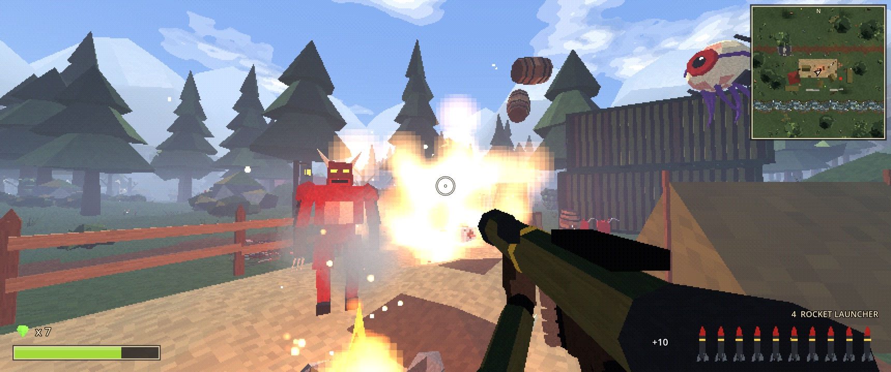
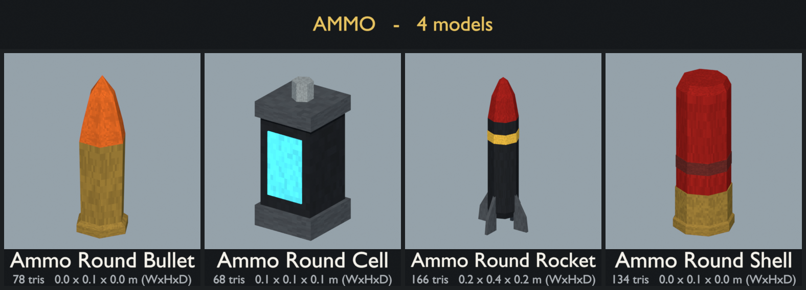

# Opus FPS - A experiment with Opus 5.5 creating an old school looking Godot based FPS



A first-person shooter with a PS1 look, made in Godot 4. Hunt floating eyes and electric rock golems across a hilly valley of pine groves, a village, an outpost and ruins. Blow up gas cans and barrels, collect gems and step through linked portals. Every model and sound is generated by scripts in `tools/`.

The game is in `godot/`. See [godot/README.md](godot/README.md) for how to run it, the controls and how the code fits together.

## PS1-style asset pack


The models in `assets/` are generated by `tools/generate_assets.py`. Preview images in `assets/previews/` are rendered by `tools/render_previews.py`. To regenerate, run:

```
B=/Applications/Blender.app/Contents/MacOS/Blender
$B -b --factory-startup -P tools/generate_assets.py -- assets   # models + palette
$B -b --factory-startup -P tools/render_previews.py -- assets   # preview images
```

### Previews

Each sheet shows every model with its name, triangle count and size. Single-model thumbnails are in `assets/previews/models/`.




### Palette

Every model uses one shared 128×64 texture, `assets/palette.png`. It is an 8×4 grid of 16 px swatches with a little pixel noise. Each face's UVs fall inside a single swatch, so every face reads as one flat color. Glowing parts (flames, pickups, eyes, keys) use a second material, `PS1_Glow`, which samples the same texture as emissive color. A portal's membrane uses a third material, `PS1_Portal`, meant to be replaced in the engine by an animated see-through shader. A creek's water uses a fourth, `PS1_Water`, meant to be replaced by a flowing-water shader. In other engines it shows as flat see-through blue-green.

| Row | Colors |
|-----|--------|
| Nature | `#1E2B1F` `#34452E` `#586B3E` `#4F4A2A` `#251B16` `#4A3628` `#8A7A5C` `#A89A7A` |
| Stone / wood | `#24262B` `#4A4D52` `#7A7A74` `#2E211A` `#5C4030` `#806248` `#5E2522` `#C8C4B8` |
| Water / metal | `#141F2B` `#2A4252` `#5C6E7A` `#1E2024` `#44484E` `#868C90` `#8C6E30` `#0C0C0C` |
| Accents | `#8E1A16` `#C85A1E` `#D6A83A` `#6FB83A` `#3FB6C4` `#4E2A6A` `#A8705F` `#BFB08C` |

The palette is deliberately somber: cold deep greens, muddy earth, heavy stone and dried-blood roofs. The saturated accent row is kept for blood, fire, pickups and energy weapons so they stand out.

The texture sampler is set to nearest filtering. For the full PS1 look, also turn off mipmaps in your engine (e.g. three.js `texture.generateMipmaps = false; texture.minFilter = NearestFilter`). Vertex snapping and affine texture warping are shader effects and belong in the engine, not in these files.

### Conventions (glTF, Y-up, meters)

- **assets/terrain/**: 8×8 m tiles with their origin at the center. Each tile's edges sit at height 0, so tiles placed on an 8 m grid connect seamlessly. `terrain_cliff` is an 8 m wall segment that tiles along X. `terrain_mountain` is a 30 m backdrop piece. `terrain_creek` carries a creek along X, so creek tiles chain end to end. The channel is about 4 m wide at the water line and 0.75 m deep, and meanders gently between grassy banks. It holds boulders on the banks, stones breaking the surface and pebbles on the gravel bed. Its water is a flat sheet 0.4 m down using a fourth material, `PS1_Water`, whose UVs are in meters with u running downstream (+X), so an engine shader can scroll ripples along the flow.
- **assets/scenery/**: origin at ground level. `fence_wood` is a 2 m segment with a post only at its -X end, so use `fence_post` to cap the last segment. `stone_wall` tiles every 4 m. There are three bushes: `bush` is a low, spreading clump, `bush_short` is a knee-high leafy dome with red berries (about 1.1 m across, 0.7 m tall), and `bush_tall` is a head-high upright shrub, leafy almost to the ground (about 2 m across and 2 m tall). `conex` is a 20 ft military shipping container (6.06 × 2.44 × 2.59 m) in olive drab, long along X, with its cargo doors at the +X end. `gas_can` is a red 20 L steel jerry can (about 0.35 × 0.17 × 0.47 m without its spout) with its broad faces toward ±Y; the filler neck is on the chamfered top -X corner with a flexible spout clamped on, arcing out past -X. `barbed_wire` is a loose roll of rusty barbed wire lying flat (about 1.5 × 1.25 × 0.45 m): uneven loops bunched into a lumpy ring around an open middle, with the last loops sprung free and spread on the ground toward -X. At about 3,700 triangles it is the heaviest scenery model, because each loop of wire and each barb is real geometry. `portal` is a stone ring gate sunk into a low dais with sloped edges, facing +Z (you can walk through either side). Its membrane is a flat disc (`PS1_Portal`) in the XY plane, centered 0.885 m up with a 1.45 m radius. The ring's buried bottom stones are left out, so the way through is a flat floor about 2.5 m wide.
- **assets/weapons/**: origin at the grip, with the barrel pointing -Z (the direction the camera looks). They are real-world scale, so scale them up for first-person viewmodels.
- **assets/pickups/**: origin at the base, sized about 0.3–0.7 m. Spin or bob them in game.
- **assets/viewmodel/**: first-person arm parts: right and left hands closed around a pistol-style grip, a left support hand for barrels and handguards, and a forearm with a jacket sleeve. Each hand's origin is the centre of what it holds. The forearm's origin is the wrist, and it runs 0.7 m toward the elbow.
- **assets/ammo/**: one round per ammo type (bullet, shotgun shell, rocket, plasma cell) for the HUD ammo counter. Origin at the base, standing upright, real-world scale.
- **assets/enemies/**: origin at the feet, facing +Z. `enemy_floating_eye` has its origin at its center, so hover it in game. It is the one rigged model: each of its five tentacles is skinned to a four-bone chain (`tentacle_<k>_0` at the root to `tentacle_<k>_3` at the tip) under a `body` bone, so they can be posed or animated. The other models are static meshes. `enemy_golem` has no legs: its origin is under its two hip boulders, and the game floats it on electric arcs.
