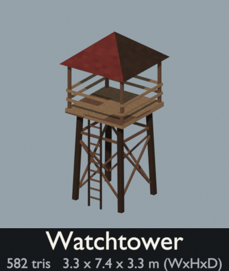
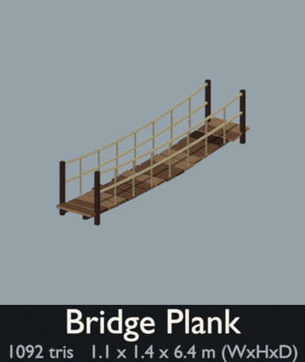
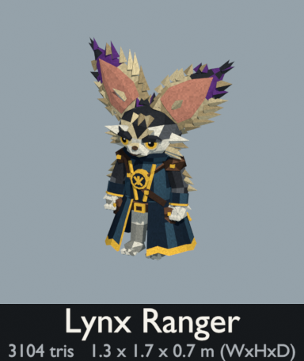
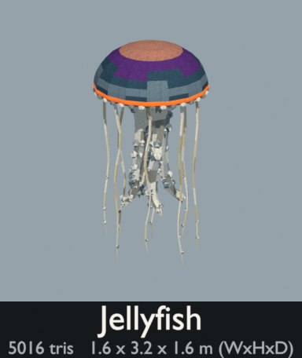

# Opus FPS - A experiment with Opus 5.5 creating an old school looking Godot based FPS


A first-person shooter with a PS1 look, made in Godot 4. Hunt floating eyes, electric rock golems and toxin-spitting giant spiders across a hilly valley of pine groves, a village, an outpost and ruins. Or visit a small island in an open sea, where a shadow cat with a spiked tail prowls the beach, a lynx ranger in a navy coat potters about, and an arcane eye and a big jellyfish drift overhead. Blow up gas cans and barrels, collect gems and step through linked portals. Every model and sound is generated by scripts in `tools/`.

The game is in `godot/`. See [godot/README.md](godot/README.md) for how to run it, the controls and how the code fits together.

## PS1-style asset pack


The models in `assets/` are generated by `tools/generate_assets.py`. Preview images in `assets/previews/` are rendered by `tools/render_previews.py`. To regenerate, run:

```
B=/Applications/Blender.app/Contents/MacOS/Blender
$B -b --factory-startup -P tools/generate_assets.py -- assets   # models + palette
$B -b --factory-startup -P tools/render_previews.py -- assets   # preview images
```

### Previews

Each sheet shows every model with its name, triangle count and size. Single-model thumbnails are in `assets/previews/models/`.


### Palette

Every model uses one shared 128×64 texture, `assets/palette.png`. It is an 8×4 grid of 16 px swatches with a little pixel noise. Each face's UVs fall inside a single swatch, so every face reads as one flat color. Glowing parts (flames, pickups, eyes, keys) use a second material, `PS1_Glow`, which samples the same texture as emissive color. A portal's membrane uses a third material, `PS1_Portal`, meant to be replaced in the engine by an animated see-through shader. A creek's water uses a fourth, `PS1_Water`, meant to be replaced by a flowing-water shader. In other engines it shows as flat see-through blue-green.

| Row | Colors |
|-----|--------|
| Nature | `#1E2B1F` `#34452E` `#586B3E` `#4F4A2A` `#251B16` `#4A3628` `#8A7A5C` `#A89A7A` |
| Stone / wood | `#24262B` `#4A4D52` `#7A7A74` `#2E211A` `#5C4030` `#806248` `#5E2522` `#C8C4B8` |
| Water / metal | `#141F2B` `#2A4252` `#5C6E7A` `#1E2024` `#44484E` `#868C90` `#8C6E30` `#0C0C0C` |
| Accents | `#8E1A16` `#C85A1E` `#D6A83A` `#6FB83A` `#3FB6C4` `#4E2A6A` `#A8705F` `#BFB08C` |

The palette is deliberately somber: cold deep greens, muddy earth, heavy stone and dried-blood roofs. The saturated accent row is kept for blood, fire, pickups and energy weapons so they stand out.

The texture sampler is set to nearest filtering. For the full PS1 look, also turn off mipmaps in your engine (e.g. three.js `texture.generateMipmaps = false; texture.minFilter = NearestFilter`). Vertex snapping and affine texture warping are shader effects and belong in the engine, not in these files.

### Conventions (glTF, Y-up, meters)

- **assets/terrain/**: 8×8 m tiles with their origin at the center. Each tile's edges sit at height 0, so tiles placed on an 8 m grid connect seamlessly. `terrain_cliff` is an 8 m wall segment that tiles along X. `terrain_mountain` is a 30 m backdrop piece. `terrain_creek` carries a creek along X, so creek tiles chain end to end. The channel is about 4 m wide at the water line and 0.75 m deep, and meanders gently between grassy banks. It holds boulders on the banks, stones breaking the surface and pebbles on the gravel bed. Its water is a flat sheet 0.4 m down using a fourth material, `PS1_Water`, whose UVs are in meters with u running downstream (+X), so an engine shader can scroll ripples along the flow.
- **assets/scenery/**: origin at ground level. `fence_wood` is a 2 m segment with a post only at its -X end, so use `fence_post` to cap the last segment. `stone_wall` tiles every 4 m. There are three bushes: `bush` is a low, spreading clump, `bush_short` is a knee-high leafy dome with red berries (about 1.1 m across, 0.7 m tall), and `bush_tall` is a head-high upright shrub, leafy almost to the ground (about 2 m across and 2 m tall). `conex` is a 20 ft military shipping container (6.06 × 2.44 × 2.59 m) in olive drab, long along X, with its cargo doors at the +X end. `gas_can` is a red 20 L steel jerry can (about 0.35 × 0.17 × 0.47 m without its spout) with its broad faces toward ±Y; the filler neck is on the chamfered top -X corner with a flexible spout clamped on, arcing out past -X. `barbed_wire` is a loose roll of rusty barbed wire lying flat (about 1.5 × 1.25 × 0.45 m): uneven loops bunched into a lumpy ring around an open middle, with the last loops sprung free and spread on the ground toward -X. At about 3,700 triangles it is the heaviest scenery model, because each loop of wire and each barb is real geometry. `watchtower` is a lookout with a 3.6 m square deck 4.7 m up under a pyramid roof. A ladder on its +Z side climbs to a gap in the railing, and a second gap on the -Z side is where `bridge_plank` docks. `bridge_plank` is a 6.4 m plank footbridge with rope handrails, long along Z, whose deck is at height 0 at both ends and sags 0.15 m in the middle. Two towers facing each other 9.7 m apart (center to center) with the bridge between them at deck height have its last 0.15 m at each end resting on their decks. `portal` is a stone ring gate sunk into a low dais with sloped edges, facing +Z (you can walk through either side). Its membrane is a flat disc (`PS1_Portal`) in the XY plane, centered 0.885 m up with a 1.45 m radius. The ring's buried bottom stones are left out, so the way through is a flat floor about 2.5 m wide.

   

- **assets/weapons/**: origin at the grip, with the barrel pointing -Z (the direction the camera looks). They are real-world scale, so scale them up for first-person viewmodels.
- **assets/pickups/**: origin at the base, sized about 0.3–0.7 m. Spin or bob them in game.
- **assets/viewmodel/**: first-person arm parts: right and left hands closed around a pistol-style grip, a left support hand for barrels and handguards, and a forearm with a jacket sleeve. Each hand's origin is the centre of what it holds. The forearm's origin is the wrist, and it runs 0.7 m toward the elbow.
- **assets/ammo/**: one round per ammo type (bullet, shotgun shell, rocket, plasma cell) for the HUD ammo counter. Origin at the base, standing upright, real-world scale.
- **assets/enemies/**: origin at the feet, facing +Z. `enemy_floating_eye` has its origin at its center, so hover it in game. It, `enemy_spider`, `enemy_shadow_cat`, `enemy_arcane_eye`, `enemy_lynx_ranger` and `enemy_jellyfish` (below) are rigged: each of the eye's five tentacles is skinned to a four-bone chain (`tentacle_<k>_0` at the root to `tentacle_<k>_3` at the tip) under a `body` bone, and each of the spider's eight legs to two bones, `leg_<side>_<k>_0` (hip to knee) and `leg_<side>_<k>_1` (knee to toe), side `l` or `r` and k = 0 at the front, under a `body` bone that carries the rest of it, so they can be posed or animated. The other models are static meshes. `enemy_golem` has no legs: its origin is under its two hip boulders, and the game floats it on electric arcs. `enemy_shadow_cat` is a black chibi cat about 1.4 m tall to its ear tips (1.0 × 1.5 m across and long), caught mid-stride with its right forepaw raised (the raised leg's segments match the planted one's, so it can be walked): an oversized head with huge leaf-shaped ears, glowing red crescent eyes (`PS1_Glow`) that drip down its face, spiky fur at its brow, cheeks and chest, and a bushy, bristling tail curling up over its back. It's rigged for animation, with its rest pose as modeled. Sides are the cat's own: `l` is +X and `r` is -X. The bones are `hips` (the root, at the rump) > `chest` > `neck` > `head` > `ear_<side>_0` > `ear_<side>_1` (each ear bends a third of the way up). The front legs hang from `chest` as `leg_f<side>_0` (shoulder to elbow) > `leg_f<side>_1` (to the wrist) > `paw_f<side>`. The hind legs hang from `hips` as `leg_b<side>_0` (hip to knee) > `leg_b<side>_1` (to the hock) > `leg_b<side>_2` (to the ankle) > `paw_b<side>`. The tail is a chain from `hips`, `tail_0` at its root to `tail_5` at its tip. The eyes and head tufts follow `head`, the chest ruff `chest`, and each tail tuft the joint it grows from. Joints are skinned half to each neighbouring bone, so they bend smoothly. The game walks it around the island and gives it its tail attack, including the spikes (`godot/scripts/enemies/shadow_cat.gd`). `enemy_arcane_eye` is an ornate floating eye, about 1.4 m across, 1 m deep and 2 m tall with its hangings, with its origin at the eyeball's center (hover it in game): a pale, veined eyeball with a glowing violet iris (`PS1_Glow`), a black slit pupil and a white glint, set in a thorny brass frame with crescent horns, a crowned gem on top and violet gems round the rim. From behind, a brass cage holds the eyeball. One thorny strap runs from the crown over the back to the bottom of the rim and another runs across from side to side. Where they cross sits a medallion of brass rings and spikes round a violet gem, and two violet sashes are draped across the back from the upper corners. Five chains hang from the frame, each ending in a violet crystal, and tattered violet cloth hangs at each side. It's rigged so every hanging can swing and bend. `body` (the eye and frame) carries each chain as `pendant_<k>_0` > `pendant_<k>_1` > `pendant_<k>_2`, top to bottom with the crystal on the last bone (k = 0 to 4 from left to right). It also carries each of the ten cloth strips as `cloth_<side>_<k>_0` > `_1` > `_2`, top to bottom (`l` at -X and `r` at +X as seen from the front, k = 0 to 4 from the inside out). Each chain link follows one bone, and the cloth bends smoothly between its bones. It has fleshy eyelids with a dark red rim, each on its own bone hinged at the eye's center (`lid_upper` and `lid_lower`). At rest they're open, folded back above and below the iris. Turning them 50° about X (`LID_OPEN` in the generator), upper down and lower up, shuts them across the middle of the eye. It has no attack: the game floats it about the island (`godot/scripts/enemies/arcane_eye.gd`). `enemy_lynx_ranger` is a chibi lynx kit in a ranger's coat, about 1.7 m tall to its ear tips (1.3 m across the ears), modeled on a piece of concept art. It has an oversized head with huge splayed ears: tan-brown behind shading to dark purple tips, pink inside, and fringed with tan fur. Its amber eyes are half-lidded under heavy dark lids, with a smug smirk below, a cream muzzle, cheek fluff and a dark crest with tan locks. Its navy coat is open at the front over grey legs, with gold front edges and a scalloped gold hem, and a gold diamond and arcs on the back. It also has a rolled collar over a white shirt, a gold medallion, a leather bandolier, a hip belt with a gold buckle and pouches, leather shoulder guards, furry dark sleeves with gold-edged navy bracers, white paws and big grey toed feet. It's rigged for animation, with its rest pose as modeled and the arms hanging. Sides are its own: `l` is +X and `r` is -X. The bones are `hips` (the root, at the waist) > `chest` > `head` > `ear_<side>_0` > `ear_<side>_1` (each ear bends a third of the way up). The arms hang from `chest` as `arm_<side>_0` (shoulder to elbow) > `arm_<side>_1` (to the wrist) > `hand_<side>`. The legs hang from `hips` as `leg_<side>_0` (hip to knee) > `leg_<side>_1` (to the ankle) > `foot_<side>`. The coat's skirt, belt and pouches follow `hips`. The torso blends from `hips` to `chest` up the waist, and the collar, straps, medallion and shoulder guards follow `chest`. Everything on the head follows `head`, and joints are skinned across their neighbouring bones so they bend smoothly. The game has it stroll about the island (`godot/scripts/enemies/lynx_ranger.gd`). `enemy_jellyfish` is a big jellyfish, about 1.6 m across its bell and 3.2 m tall with its tentacles, with its origin at the middle of the bell's rim (hover it in game). Its domed bell shades from a pinkish crown through violet to ribbed blue round its sides. A glowing orange band (`PS1_Glow`) runs above a scalloped rim of pale lappets. Under it hang four frilly oral arms, pale and studded with bulbs and curling at their ends, and eight long pale ribbon tentacles from just inside the rim. It's rigged so it can pulse and its hangings can swing. `body` (the root) carries `bell`, which the game scales to pulse the bell. Each hanging is a chain of equal bones hanging straight down at rest, top to bottom: `arm_<k>_0` to `arm_<k>_4` for the oral arms (k = 0 to 3) and `tentacle_<k>_0` to `tentacle_<k>_3` for the tentacles (k = 0 to 7), each skinned smoothly along its bones. The game has it swim through the air over the island (`godot/scripts/enemies/jellyfish.gd`).

   
