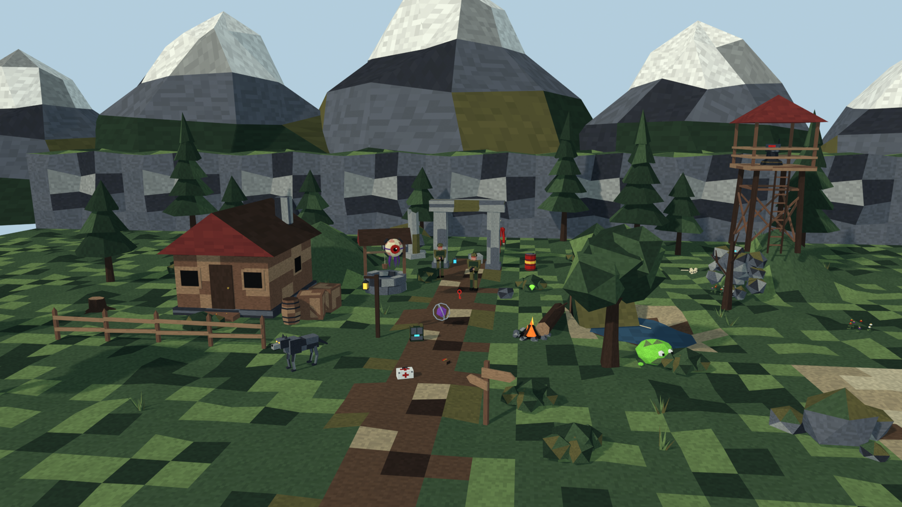
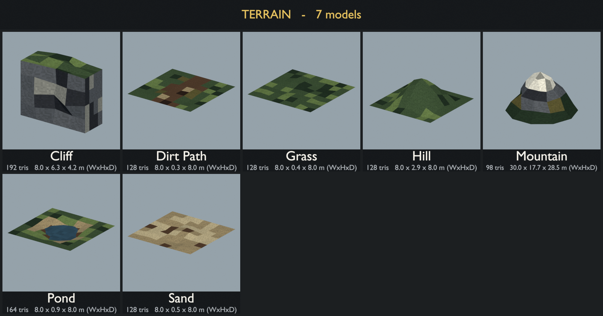
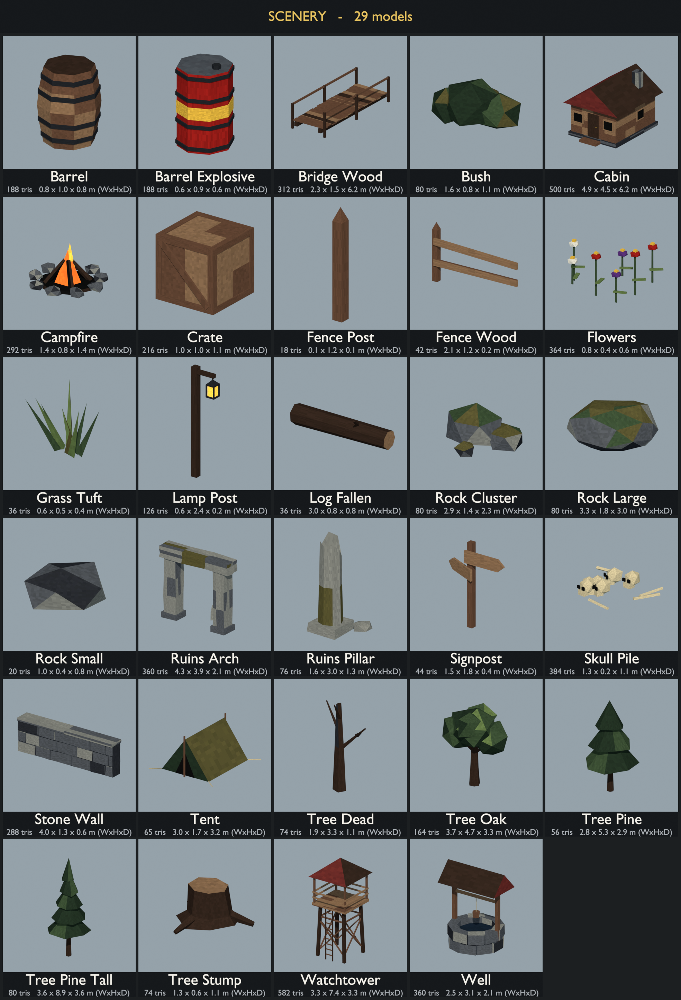
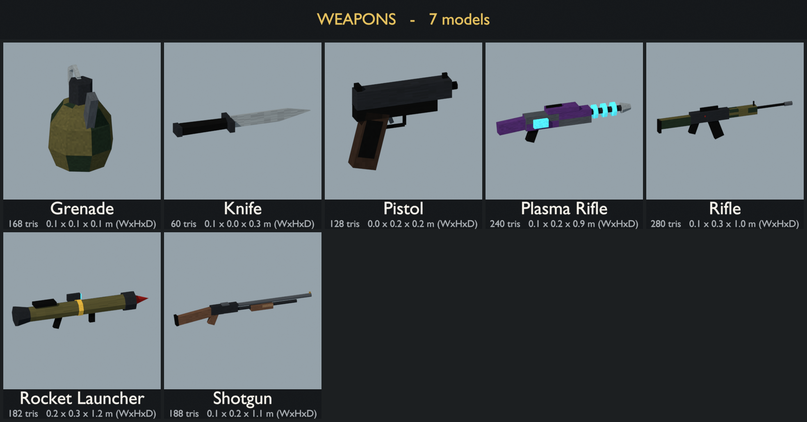
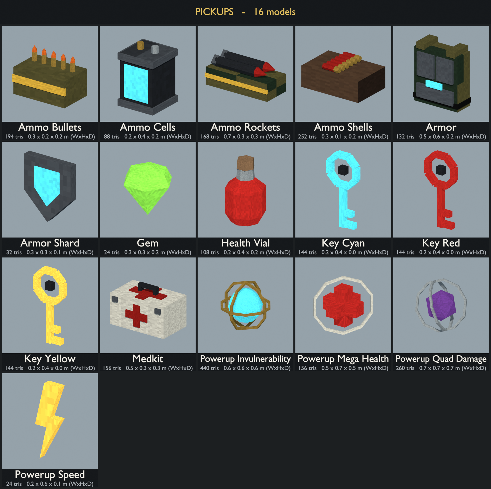
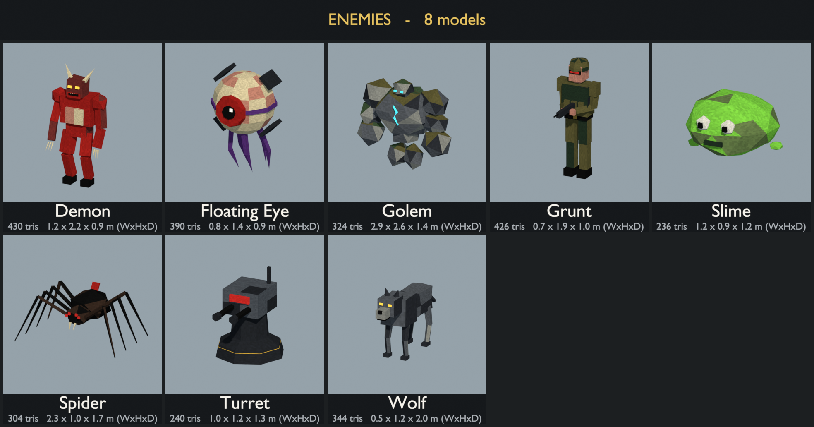

# PS1-style asset pack



Generated by `tools/generate_assets.py`. Preview images in `previews/` are rendered by `tools/render_previews.py`. To regenerate, run:

```
B=/Applications/Blender.app/Contents/MacOS/Blender
$B -b --factory-startup -P tools/generate_assets.py -- assets   # models + palette
$B -b --factory-startup -P tools/render_previews.py -- assets   # preview images
```

## Previews

Each sheet shows every model with its name, triangle count and size. Single-model thumbnails are in `previews/models/`.







## Palette

Every model uses one shared 128×64 texture, `palette.png`. It is an 8×4 grid of 16 px swatches with a little pixel noise. Each face's UVs fall inside a single swatch, so every face reads as one flat color. Glowing parts (flames, pickups, eyes, keys) use a second material, `PS1_Glow`, which samples the same texture as emissive color.

| Row | Colors |
|-----|--------|
| Nature | `#1E2B1F` `#34452E` `#586B3E` `#4F4A2A` `#251B16` `#4A3628` `#8A7A5C` `#A89A7A` |
| Stone / wood | `#24262B` `#4A4D52` `#7A7A74` `#2E211A` `#5C4030` `#806248` `#5E2522` `#C8C4B8` |
| Water / metal | `#141F2B` `#2A4252` `#5C6E7A` `#1E2024` `#44484E` `#868C90` `#8C6E30` `#0C0C0C` |
| Accents | `#8E1A16` `#C85A1E` `#D6A83A` `#6FB83A` `#3FB6C4` `#4E2A6A` `#A8705F` `#BFB08C` |

The palette is deliberately somber: cold deep greens, muddy earth, heavy stone and dried-blood roofs. The saturated accent row is kept for blood, fire, pickups and energy weapons so they stand out.

The texture sampler is set to nearest filtering. For the full PS1 look, also turn off mipmaps in your engine (e.g. three.js `texture.generateMipmaps = false; texture.minFilter = NearestFilter`). Vertex snapping and affine texture warping are shader effects and belong in the engine, not in these files.

## Conventions (glTF, Y-up, meters)

- **terrain/**: 8×8 m tiles with their origin at the center. Each tile's edges sit at height 0, so tiles placed on an 8 m grid connect seamlessly. `terrain_cliff` is an 8 m wall segment that tiles along X. `terrain_mountain` is a 30 m backdrop piece.
- **scenery/**: origin at ground level. `fence_wood` is a 2 m segment with a post only at its -X end, so use `fence_post` to cap the last segment. `stone_wall` tiles every 4 m.
- **weapons/**: origin at the grip, with the barrel pointing -Z (the direction the camera looks). They are real-world scale, so scale them up for first-person viewmodels.
- **pickups/**: origin at the base, sized about 0.3–0.7 m. Spin or bob them in game.
- **viewmodel/**: first-person arm parts: right and left hands closed around a pistol-style grip, a left support hand for barrels and handguards, and a forearm with a jacket sleeve. Each hand's origin is the centre of what it holds. The forearm's origin is the wrist, and it runs 0.7 m toward the elbow.
- **enemies/**: origin at the feet, facing +Z. `enemy_floating_eye` has its origin at its center, so hover it in game. Models are static meshes (not rigged).
